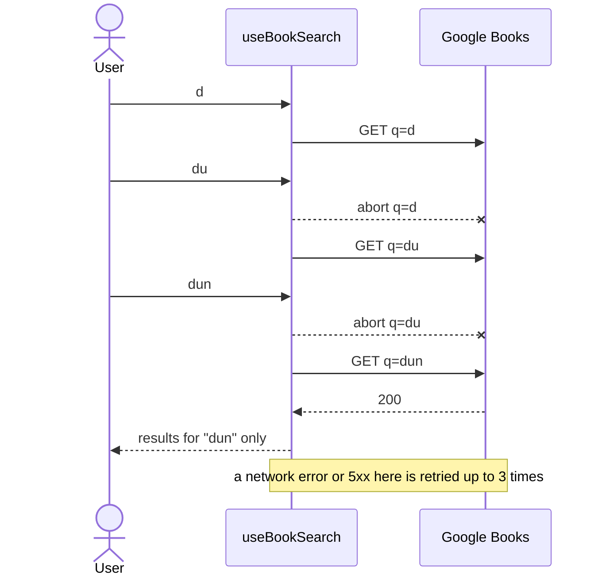

# Book Search

Test task for WiNK. A React app that searches Google Books: live search, pagination, page size
(5/10/15/20) and a details page with the `infoLink`.

Stack: React 19, TypeScript, Redux Toolkit (RTK Query), React Router, Bootstrap 5 with Sass.

**Live:** https://wink-books-app.vercel.app (backup demo, always on). The CodeSandbox link is in
the email, a sandbox that was asleep takes a few seconds to wake up.

## Run

Node 24 is needed (there is an `.nvmrc`).

```bash
nvm use
npm ci
cp .env.example .env.local
npm run dev
```

Put your Google Books API key into `.env.local`, then open http://localhost:5173.

```bash
npm run lint
npm run typecheck
npm test
npm run build
```

## About the API key

The endpoint from the task (`/books/v1/volumes?q=...`) does not work without a key anymore. Google
answers with 429 and a daily limit of 0 for anonymous requests. With a free key it works fine.

To get one: Google Cloud Console, enable Books API, create an API key, restrict it to Books API and
to the sites where the app runs (localhost and the preview URL).

The key ends up in the browser bundle like any `VITE_` variable, so it is protected by those
restrictions and not by being secret. It is not in the repo, `.env.example` is empty. If the key is
missing the app says so.

On CodeSandbox I set it in the sandbox env variables.

## Notes

- Search state (`q`, `page`, `limit`) is in the URL, so reload, back/forward and sharing a link
  just work. Redux only keeps the server data (RTK Query cache).
- Search is live with no delay, as the task says: every typed character starts a search and the
  previous request is aborted. Pages that were already loaded come from the cache. If you prefer a
  debounce, it is one constant (`SEARCH_DEBOUNCE_MS` in `SearchBar.tsx`).
- The list only shows data for the current query, so a slow old response can't replace new results.
- While another page of the same search loads, the current page stays on screen (dimmed), so the
  layout does not jump. A new query shows skeletons instead, never the books of the old one.
- Pointing at Previous/Next loads that page ahead, so the click is usually instant.
- The list asks Google only for the fields it shows (`fields=`), the response is about 3 times
  smaller (38 KB -> 12 KB for 10 books).
- Requests time out after 10 s, and what is on screen is fetched again when the connection is back.
- A request that fails because of the network or a 5xx is repeated up to 3 times before the user
  sees an error with a "Try again" button. 4xx answers are not repeated, a 429 would only burn more
  quota. The rule lives in one place, `entities/book/baseQuery.ts`.
- If a part of the page crashes while rendering, only that part shows an error (`ErrorBoundary`):
  one broken book card does not take down the list, and the search bar stays usable.
- `totalItems` from Google is not reliable. It grows on later pages and promises far more than the
  API returns ("harry potter" says 476 on page 1, 21 762 later, and the books end around 400). The
  page count uses the smallest total seen for the query and is cut at the first empty page. On an
  empty page one button finds the real last page (it halves the range, about 7 requests).
- For books that are not for sale Google sends a Play Store `infoLink` that opens a 404. In that
  case the button opens the Google Books page of the same volume.
- Only books are requested (`printType=books`), by default the endpoint also returns magazines.
- Book descriptions come as HTML. In the list they are plain text. On the book page the
  formatting is kept, but the HTML is never injected: the parsed tree is rebuilt from React
  elements, only a few tags are allowed and attributes are dropped (`BookDescription.tsx`).
- Light and dark theme, the choice is saved. The first visit follows the system setting.
- Bootstrap instead of Tailwind because the task has Bootstrap in "Required". Theme colours are in
  `src/app/styles/_theme.scss`. `#FF5039` is used for the cover placeholder as asked and as the
  accent colour, but text links and buttons use a darker shade, white on `#FF5039` is hard to read.

What happens when you type `dun`:



## Structure

```
src/
  app/        store, routes, styles
  pages/      search, book-details, not-found
  entities/   book: api, retries, types, mapping, cover, description
  shared/     config, theme, error boundary and alerts
  test/       test helpers
```

## Tests

`npm test` runs 138 tests (Vitest + Testing Library). `fetch` is replaced with a stub that records
every request and its `AbortSignal`, and the app is rendered in `StrictMode` like in production
code, so the tests check real behaviour: one request per character, cancelled requests, late
responses, cache hits, automatic retries, the real end of the results, error states, Back/Forward,
focus, the theme switch, prefetching and the sanitised description. Layout was checked by hand on 360, 768 and
1280 px.

## Requirements, and where to look

Each row: what the task asks, how to see it in the running app, and where the code and test are.

| Task                                    | Try it                                                         | Code                                           | Test                                                  |
| --------------------------------------- | -------------------------------------------------------------- | ---------------------------------------------- | ----------------------------------------------------- |
| React SPA, responsive                   | resize the window, open a book, go back: no page reload        | `src/app/App.tsx`, `src/app/styles/main.scss`  | checked by hand at 360 / 768 / 1280 px                |
| `GET /books/v1/volumes?q=`              | type `dune`, see the request in the Network tab                | `entities/book/booksApi.ts`                    | "searches on every typed character"                   |
| Search bar, live on every character     | type slowly: results change after each letter, no Enter        | `pages/search/SearchBar.tsx`, `useBookSearch.ts` | `SearchPage.test.tsx`, "live search"                |
| Pagination through API parameters       | go to page 3: `startIndex=20&maxResults=10` in the request     | `entities/book/booksApi.ts`                    | "changes the page with startIndex"                    |
| Number of pages depends on the total    | change "Per page": the last page number changes                | `pages/search/pagination.ts`, `entities/book/searchBounds.ts` | `pagination.test.ts`, "does not trust a total" |
| Page size 5, 10, 15, 20                 | the "Per page" select                                          | `pages/search/PageSizeSelect.tsx`              | "changes the page size", "ignores broken values"      |
| Paginator                               | Previous / numbers / Next under the list                       | `pages/search/Paginator.tsx`                   | "derives the number of pages"                         |
| Detail page with the book info          | click a title or a cover                                       | `pages/book-details/BookDetailsPage.tsx`       | `BookDetailsPage.test.tsx`                            |
| `infoLink` on the detail page           | "View on Google Books" button                                  | `entities/book/mapVolume.ts`                   | "links to the infoLink", `mapVolume.test.ts`          |
| Placeholder when there is no image      | search `report 1890`: red "Book Cover" tiles                   | `PLACEHOLDER_COVER_URL` in `mapVolume.ts`      | "uses the WiNK placeholder"                           |
| Description cut to 2 lines with "..."   | any long description in the list                               | `.book-description` in `main.scss`             | checked by hand                                       |
| Latest Bootstrap                        | `bootstrap` 5.3.9 in `package.json`                            | `src/app/styles/main.scss`                     | -                                                     |
| Nice to have: theme colours with Sass   | coral accent, buttons, paginator                               | `src/app/styles/_theme.scss`                   | -                                                     |
| Nice to have: Redux Toolkit             | Redux DevTools: `booksApi` cache                               | `src/app/store.ts`, `entities/book/booksApi.ts` | all page tests run with the real store               |
| Nice to have: TypeScript                | `npm run typecheck`                                            | strict mode, no `any`                          | -                                                     |

Not asked, but handled: cancelled requests, late responses, cache, automatic retries, error
states (no key, quota, network, 400, 404, empty far page), render crashes, Back/Forward while
typing, focus coming back to the opened book.

## Known limitations

- Google does not say where the results really end. The page count is the best estimate we have,
  and the last pages can still be empty until one of them is opened. The button on an empty page
  then finds the real end.
- Every keystroke is a request, as the task asks. Cancelled requests still count against the
  daily quota of the API key. The debounce constant is there for that case.
- "Back to results" uses the browser history, so a book opened in a new tab links back to the plain
  search page.
- The two-line clamp, the layout and the colours are checked by hand, not by tests.
- The API key is visible in the bundle, like any key used from a browser. It is restricted to the
  Books API and to the sites of this app. A small backend proxy would be the real fix.
